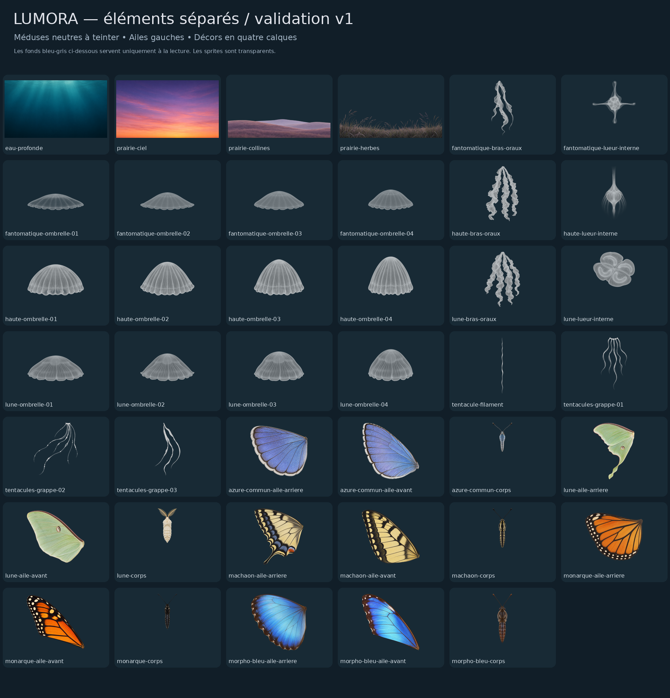

# assets/ : illustrations de Lumora

**Livraison v1 déposée le 30 octobre 2026, à valider avant intégration.** Les 41 éléments sont disponibles en PNG et en WebP, côte à côte dans leurs dossiers de thème. Ils ont été générés avec l'aide d'un outil d'intelligence artificielle.

- [Planche-contact de tous les éléments](planche-contact.png)
- [Décors assemblés pour validation](apercus/apercu-ambiances.jpg)
- [Contrôle animé des méduses et de leur teinte](apercus/controle-pulsation.webp)
- [Guide d'assemblage et d'intégration](GUIDE_INTEGRATION.md)
- [Manifeste : fichiers, dimensions, pivots, poids et sommes SHA-256](manifest.json)
- [Rapport de vérification](verification.json), [prompts de génération](prompts.json), [licence des illustrations](LICENCE.md)



## Organisation

```text
assets/
  meduses/                 ombrelles, bras oraux, lueurs et tentacules (PNG + WebP)
  papillons/               ailes gauches séparées et corps avec antennes (PNG + WebP)
  decors/                  eau profonde, ciel, collines et herbes (PNG + WebP)
  apercus/                 contrôles de composition et d'animation, hors budget de chargement
  planche-contact.png      aperçu de tous les éléments
  manifest.json            chemins relatifs à assets/, dimensions et repères
  GUIDE_INTEGRATION.md      instructions et limites pour l'intégration
  LICENCE.md                licence des illustrations
```

Les ZIP et les générations brutes ne sont pas dupliqués dans ce dépôt : les éléments destinés à l'assemblage sont directement accessibles comme fichiers individuels.

## Contenu et poids

- **Méduses : 22 éléments.** Trois types, chacun avec quatre états d'ombrelle, un groupe de bras oraux et une lueur interne; un filament et trois grappes de tentacules partagés. Blanc/gris neutre, alpha partiel, pour une teinte par le code.
- **Papillons : 15 éléments.** Monarque, morpho bleu, azuré commun, machaon et Actias luna : aile avant gauche, aile arrière gauche et corps avec antennes; les ailes droites se construisent par symétrie.
- **Décors : 4 calques.** Eau profonde; ciel de prairie; collines et herbes transparentes. Sans créatures.

Les **41 WebP totalisent 5,46 Mo** : **2,87 Mo pour les méduses avec leur décor**, **2,59 Mo pour les papillons avec leur prairie**. Les **41 PNG de référence totalisent 26,76 Mo**. Le budget léger est respecté avec les WebP; charger les deux variantes ensemble n'est pas utile. Les aperçus et la documentation ne sont pas des éléments de la scène à charger.

## Format, style et limites

PNG 32 bits (RVB + alpha), sRGB. Créatures sur un canevas de 1024 × 1024 avec marges. Décors exportés en 2560 × 1440, rééchantillonnés à partir de générations de 1672 × 941. Eau et ciel sont opaques; les sprites, collines et herbes ont une transparence réelle. Les WebP des méduses sont sans perte et conservent exactement le gris et l'alpha des PNG.

Style réaliste doux, sans visages humanisés ni contours dessinés. Les motifs sont inspirés des espèces, sans prétention de référence scientifique. Actias luna est un papillon nocturne.

Les ombrelles partagent le pivot **(512, 760)** : cycle conseillé **01 → 02 → 03 → 04 → 03 → 02**, avec fondus croisés. Les pivots des ailes sont estimés et restent à ajuster à l'assemblage. Le filament est prévu pour être étiré ou déformé; il n'est pas garanti raccordable par répétition bout à bout. Les lueurs internes sont des calques indépendants à positionner dans la cloche.

Le lot et ses aperçus ont été contrôlés; l'animation dans la page et les essais sur les appareils cibles restent à faire. La livraison n'intègre pas encore les images dans le minuteur.

## Règles du dépôt pour cette livraison

- **Déposer les fichiers ici uniquement; ne rien modifier en dehors de `assets/`.** En particulier, conserver `index.html`, `audio/`, `tools/` et `versions/v1-canvas/` (copie figée de la version 1).
- Un sous-dossier par thème : `meduses/`, `papillons/`, `decors/`. Garder la planche-contact à la racine de `assets/`.
- Noms en minuscules, sans accents ni espaces; petits commits clairs, sans nom d'outil ni co-auteur. Actualiser la branche distante avant d'envoyer.

## Licence des illustrations

Voir [LICENCE.md](LICENCE.md) : mêmes conditions que le reste du projet, avec la mention que les images ont été générées avec l'aide de l'intelligence artificielle. Aucun personnage, artiste ou œuvre protégée n'a été demandé comme référence.

La licence du code reste celle du fichier `LICENSE` à la racine du dépôt; cette livraison ne la modifie pas.
